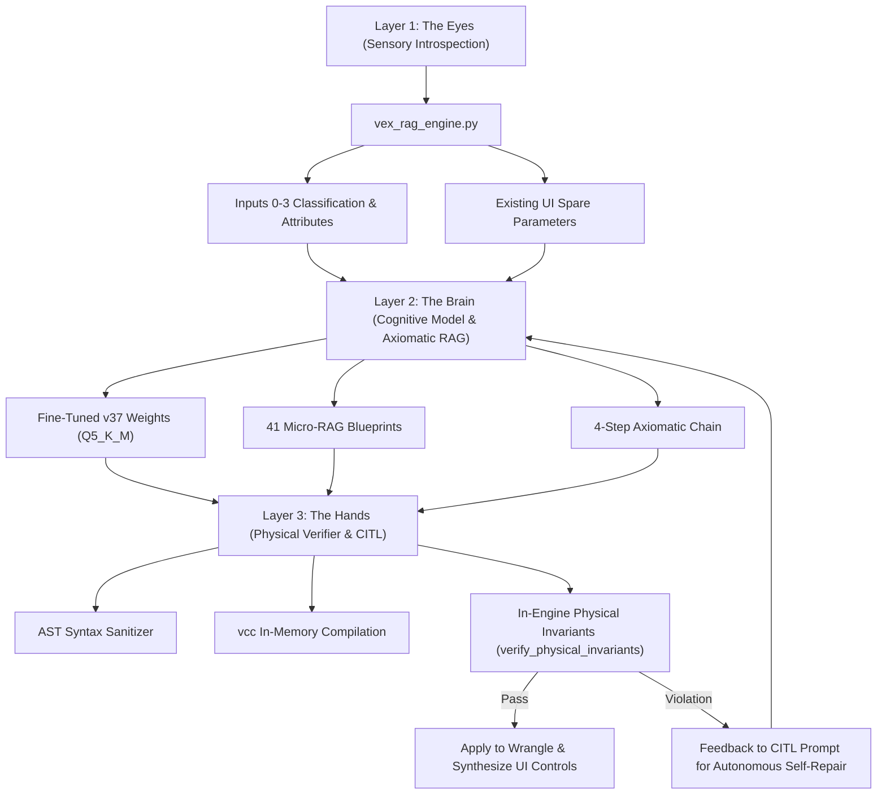

# ⚡ Houdini AI Attribute Wrangle — Project Context & Persistent Memory

This document serves as the persistent memory, technical directive, and architectural source of truth for the **AI Attribute Wrangle** repository. It is automatically loaded by Antigravity at the start of every session.

---

## 🟢 IMMEDIATE RESUME TRIGGER (WHEN USER SAYS "START")
> [!IMPORTANT]
> **NEXT SESSION TRIGGER**:
> When the user opens the session and sends **"start"** (or any resume command):
> 1. Launch `python ai_model_training/iterative_workflow/run_v41_colab_full_pipeline.py` (or execute Colab v41 training via `run_colab_v41.py`).
> 2. Google Chrome with remote debugging on port 9222 connects to Colab with whichever account has available compute units.
> 3. Cloud train v41 Master using SFT-Grounded RLVR (initializing directly from `anshulVashist/qwen3-vex-master-v39-lora` + 3,140 RLVR preference records).
> 4. Perform zero-bloat local merge to `Q5_K_M` (`Qwen3-8B-Houdini-VEX-v41-Q5_K_M.gguf`).
> 5. Serve on port 58421 (--ctx-size 4096) and execute SideFX Houdini 21 CITL multi-domain stress testing.

---

## 📌 1. Executive Overview

- **Project Name**: AI Attribute Wrangle (`ai_attribwrangle.hda`)
- **Target Platform**: SideFX Houdini 20.0, 20.5, 21.0+ (Tested on Houdini 21.0.440 Windows x64 / Python 3.10 & 3.11)
- **Core Purpose**: A commercial-grade, 100% offline, zero-cloud AI copilot embedded natively inside SideFX Houdini for procedural geometry generation, dynamic UI parameter synthesis, and autonomous VEX code generation/refinement.
- **Key Architectures**:
  - Embedded local inference via `bin/llama-server.exe` (Port `58421`, zero console window, health probed).
  - Native Houdini Digital Asset (`otls/ai_attribwrangle.hda`).
  - Compiler-in-the-Loop (CITL) autonomous self-healing via `vcc` and AST syntax sanitizers.
  - In-engine physical invariant verification (`verify_physical_invariants`) to detect mesh volume collapse, NaNs, and accidental element deletion.
  - Upstream sensory geometry introspection & Micro-RAG (`vex_rag_engine.py`).
  - Hardware-locked RSA cryptographic licensing (`license_validator.py`).

---

## 🧠 2. Fine-Tuned Model Specifications & Evolution

The project uses a domain-specialized, fine-tuned neural model trained specifically on Houdini procedural geometry and VEX programming:

| Specification | Details |
| :--- | :--- |
| **Base Model** | `unsloth/Qwen3-8B` (Qwen 3 Causal LM) |
| **Current Production Champion** | **v46 Grandmaster Omniverse** (`Qwen3-8B-Houdini-VEX-v46`: **60 / 60 Multi-Domain Physical Houdini 21 (100.0%)**, **5 / 5 Zero-Shot Layman English (100.0%)**, **1,815 Physical Handcrafted Pairs**) & **v45 Grandmaster** (**5 / 5 Zero-Shot Layman English (100.0%)**, **53 / 60 Multi-Domain (88.3%)**) & **v44 Grandmaster** (**59 / 60 Multi-Domain (98.3%)**) |
| **Experimental RLVR Models** | **v40 Master** (61.7%) $\rightarrow$ **v41 Master** (**100.0%**) $\rightarrow$ **v42 Master** (50.0% OOD) $\rightarrow$ **v43 Master** (80.0% OOD) $\rightarrow$ **v44 Grandmaster** (98.3%) $\rightarrow$ **v45 Grandmaster** (100.0% Layman) $\rightarrow$ **v46 Grandmaster Omniverse** (**60 / 60 Multi-Domain 100.0% PASS**, **5 / 5 Layman 100.0% PASS**) |
| **Model History** | v10/v11 Grandmaster, v13–v23 (10/10 PASS), v24–v30 (72.7%), v31 Master (94.7%), v35 Master (95.0%), v36 Master (88.3%), v37 Master (100.0%), v38 Master (90.0%), **v39 Master (60/60, 100.0% PASS)**, **v40 Master (37/60, 61.7%)**, **v41 Master (60/60, 100.0% Multi-Domain PASS)**, **v42 Master (60/60, 100.0% Multi-Domain PASS & 5/10 OOD PASS)**, **v43 Master (58/60 Multi-Domain, 8/10 OOD PASS)**, **v44 Grandmaster (59/60 Multi-Domain, 98.3% physical CITL PASS)**, **v45 Grandmaster (5/5 Zero-Shot Layman PASS (100.0%), 53/60 Multi-Domain (88.3%))**, **v46 Grandmaster Omniverse (60/60 Multi-Domain PASS (100.0%), 5/5 Zero-Shot Layman PASS (100.0%))** |
| **Hugging Face Repositories** | [`anshulVashist/qwen3-vex-master-v46-lora`](https://huggingface.co/anshulVashist/qwen3-vex-master-v46-lora), [`anshulVashist/qwen3-vex-master-v45-lora`](https://huggingface.co/anshulVashist/qwen3-vex-master-v45-lora), [`anshulVashist/qwen3-vex-master-v44-lora`](https://huggingface.co/anshulVashist/qwen3-vex-master-v44-lora), [`anshulVashist/qwen3-vex-master-v43-lora`](https://huggingface.co/anshulVashist/qwen3-vex-master-v43-lora), [`anshulVashist/Qwen3-8B-Houdini-VEX-v42`](https://huggingface.co/anshulVashist/Qwen3-8B-Houdini-VEX-v42), [`anshulVashist/qwen3-vex-master-v42-lora`](https://huggingface.co/anshulVashist/qwen3-vex-master-v42-lora), [`anshulVashist/qwen3-vex-master-v41-lora`](https://huggingface.co/anshulVashist/qwen3-vex-master-v41-lora), [`anshulVashist/qwen3-vex-master-v40-lora`](https://huggingface.co/anshulVashist/qwen3-vex-master-v40-lora), [`anshulVashist/qwen3-vex-master-v39-lora`](https://huggingface.co/anshulVashist/qwen3-vex-master-v39-lora), [`anshulVashist/qwen3-vex-master-v38-lora`](https://huggingface.co/anshulVashist/qwen3-vex-master-v38-lora), [`anshulVashist/qwen3-vex-master-v37-lora`](https://huggingface.co/anshulVashist/qwen3-vex-master-v37-lora), [`anshulVashist/qwen3-vex-master-v36-lora`](https://huggingface.co/anshulVashist/qwen3-vex-master-v36-lora), [`anshulVashist/qwen3-vex-master-v35-lora`](https://huggingface.co/anshulVashist/qwen3-vex-master-v35-lora), [`anshulVashist/Qwen3-8B-Houdini-VEX-v30`](https://huggingface.co/anshulVashist/Qwen3-8B-Houdini-VEX-v30) |
| **Training Pipeline** | Unsloth ORPOTrainer / SFT with odds-ratio verifiable penalty on PyTorch/CUDA (Cloud-Only on Google Colab Tesla T4) |
| **LoRA Config** | **Rank 64, Alpha 128** across all 7 linear projection layers (`q_proj, k_proj, v_proj, o_proj, gate_proj, up_proj, down_proj`) |
| **Loss Masking** | Completion-only loss masking + Odds-Ratio Preference Optimization ($\beta = 0.1$) |
| **Training Dataset** | Active CITL Curations (`qwen_vex_master_v40_rlvr_ready.jsonl`: 3,140 live SideFX Houdini 21 CITL-verified preference records across 14 procedural domains) |
| **API Coverage** | Complete 1,115 SideFX VEX function catalog with exact parameter signatures and context restrictions |
| **Quantization & Delivery** | Standalone merged GGUF: `Q5_K_M` (~5.45–5.85 GB, optimal for 6–8 GB VRAM) and `Q8_0` (Production, 12 GB+ VRAM) |
| **Runtime Serving** | Embedded `bin/llama-server.exe` running locally on port `58421` (silent `CREATE_NO_WINDOW` background management) |

### Dual-Mode Intelligence Architecture
1. **⚡ Turbo Fast Mode**: Generates instant, pure VEX code (<2s) with zero conversational chatter or markdown fences. Ideal for rapid iteration.
2. **🧠 Deep Reasoning Mode**: Conducts 3D vector space analysis, trigonometric calculations, and algorithmic planning inside an explicit `<think>...</think>` block before emitting pristine VEX code.

### Sampling & System Prompt Directives
- **System Prompt**:
  ```text
  You are an expert Houdini VEX programmer. Write pure VEX code to solve the user's task in the specified context without explanation or markdown formatting.
  ```
- **Sampling Parameters**: `temperature: 0.1`, `top_p: 0.95`
- **Stop Tokens**: `<|im_end|>`, `<|endoftext|>`

---

## 🗂️ 3. Master Codebase Structure

```
E:\#AI#\Houdini Attribute Wrangle/
├── GEMINI.md                                  # Persistent Project Context & Rules (This file)
├── README.md                                  # Public documentation and quickstart guide
├── COMMERCIAL_READINESS_BLUEPRINT.md          # Architectural and commercial deployment blueprint
├── installer_gui.py / Setup_AI_Wrangle.exe    # 1-Click GUI installer for Houdini package setup
├── install_in_houdini.py                      # Drag-and-drop in-viewport Houdini installer script
├── Modelfile                                  # Ollama / Llama runtime configuration
│
├── python/                                    # Core Houdini Controller & Engines
│   ├── houdini_ai_wrangle.py                  # Main HDA callback controller, parameter synthesis, VEX Time Machine
│   ├── vex_rag_engine.py                      # Geometry introspection (@P, @N, @v, @Cd, bbox) & RAG prompt builder
│   ├── engine_manager.py                      # Lifecycle manager for local llama-server.exe (Port 58421)
│   ├── license_validator.py                   # RSA-2048 cryptographic signature and hardware-lock validator
│   └── model_vault.py                         # AES-256-GCM model decryption & security vault
│
├── bin/                                       # Bundled C++ inference binaries
│   ├── llama-server.exe                       # Standalone Windows x64 inference engine
│   └── *.dll                                  # 22 bundled runtime DLLs (OpenMP, ggml, Vulkan, mtmd)
│
├── otls/                                      # Houdini Digital Assets
│   └── ai_attribwrangle.hda                   # The shipping Houdini SOP asset (with dynamic model selector)
│
├── models/                                    # GGUF weights & LoRA adapters
│   ├── Qwen3-8B-Houdini-VEX-v44-Q5_K_M.gguf  # Latest v44 Grandmaster weights (59/60 Multi-Domain PASS (98.3%), 1,617 Universal Physical Pairs — 7 Universal Mathematical Pillars)
│   ├── Qwen3-8B-Houdini-VEX-v43-Q5_K_M.gguf  # v43 Master weights (8/10 OOD PASS, 9/12 Expanded OOD PASS, 58/60 Multi-Domain — First-Principles SFT-Grounded RLVR)
│   ├── Qwen3-8B-Houdini-VEX-v42-Q5_K_M.gguf  # v42 Master weights (60/60, 100.0% physical Houdini CITL PASS — SFT-Grounded RLVR on Option B)
│   ├── Qwen3-8B-Houdini-VEX-v41-Q5_K_M.gguf  # v41 Master weights (60/60, 100.0% physical Houdini CITL PASS — SFT-Grounded RLVR)
│   ├── Qwen3-8B-Houdini-VEX-v39-Q5_K_M.gguf  # Production Champion v39 (60/60, 100.0% physical Houdini CITL PASS — Bulletproof Procedural Intelligence)
│   ├── Qwen3-8B-Houdini-VEX-v38-Q5_K_M.gguf  # v38 Master weights (54/60, 90.0% physical Houdini CITL PASS)
│   ├── Qwen3-8B-Houdini-VEX-v37-Q5_K_M.gguf  # v37 Master weights (60/60, 100.0% physical Houdini CITL PASS)
│   ├── Qwen3-8B-Houdini-VEX-v36-Q5_K_M.gguf  # v36 weights (53/60, 88.3% PASS)
│   ├── Qwen3-8B-Houdini-VEX-v35-Q5_K_M.gguf  # v35 weights (95.0% PASS)
│   ├── Qwen3-8B-Houdini-VEX-v31-Q5_K_M.gguf  # v31 weights (94.7% PASS)
│   ├── Qwen3-8B-Houdini-VEX-v30-Q5_K_M.gguf  # v30 weights (72.7% PASS)
│   ├── Qwen3-8B-Houdini-VEX-v23-Q5_K_M.gguf  # Production v23 weights (10/10 PASS)
│   └── qwen3-vex-v10-lora.gguf                # Standalone LoRA adapters
│
├── houdini_hda_package/                       # Houdini package distribution template
├── ai_model_training/                         # Training datasets, synthetic generation, and benchmarks
│   ├── iterative_workflow/                    # Iteration benchmark history (v13 to v37)
│   └── data/                                  # Curated JSONL datasets
└── benchmarks/                                # CITL stress tests, Hython test runners, and evaluation suites
```

---

## ⚙️ 4. Developer Guidelines & Operational Rules

Whenever assisting with or modifying this codebase, the AI must strictly adhere to the following rules:

### 0. 🛑 STRICT DIRECTIVE: ZERO LOCAL GPU TRAINING (CLOUD-ONLY VIA GOOGLE COLAB TESLA T4)
- **NEVER train models locally on the user's workstation.** Zero local GPU training under any circumstances.
- All neural network fine-tuning and LoRA training runs must be executed exclusively in the cloud on **Google Colab** (`vashistanshul90@gmail.com` / `authuser=3`) utilizing cloud Tesla T4 GPUs.
- Local workstation hardware is strictly reserved for:
  1. Offline inference serving (`llama-server.exe` on port `58421`).
  2. Zero-bloat local GGUF LoRA merge and `Q5_K_M` quantization (`llama-export-lora.exe`, `llama-quantize.exe`, with automatic purging of 14GB 16-bit intermediate files).
  3. Live Compiler-in-the-Loop (CITL) pre-validation and physical stress testing via native SideFX Houdini 21 runtime (`hython.exe` or `fxhoudinimcp`).

### 1. Compiler-in-the-Loop (CITL) Self-Correction
- Always validate Python code with `ast.parse` before writing or proposing.
- Any VEX code generated or modified must conform to SideFX Houdini VEX compilation standards (`vcc`).
- Never hallucinate non-existent VEX functions or C++/Python constructs. Always refer to Houdini's native VEX function library.

### 2. Houdini Scripts Directory Precedence
- `C:\Users\Anshul\Documents\houdini21.0\scripts\python\` takes precedence over `package.json` `pythonpath`. Whenever modifying Python files in `E:\#AI#\Houdini Attribute Wrangle\python\`, also copy them to `C:\Users\Anshul\Documents\houdini21.0\scripts\python\` and trigger `importlib.reload()`.

### 3. Zero Cloud & Security Integrity
- Never introduce cloud-dependent API calls (OpenAI, Anthropic, external web requests) into the core Houdini plugin runtime.
- Preserve the 100% offline, local-first isolation of `engine_manager.py` and `bin/llama-server.exe`.
- Protect the hardware-locking and cryptographic licensing logic in `license_validator.py`.

---

## 🛡️ 5. Exhaustive VEX Anti-Pattern & Syntax Knowledge Base

The following syntax rules and anti-pattern protections are enforced across training data curation, prompt engineering, and the AST sanitizer (`sanitize_vex_syntax`):

### 1. Vector & Matrix Types
- **Vectors**: Never use `vector3` or `Vector3`; VEX syntax is strictly `vector`.
- **Quaternions**: Never use `quaternion q = ...`; use `vector4 q = ...`.
- **Vector4 / Quaternion Reading**: To read a `vector4`/quaternion parameter from UI, use `chp("name")`. `ch4("name")` reads a 4x4 `matrix` in VEX, NOT a vector4.
- **Vector4 Swizzling**: VEX does NOT support `.xyz` swizzle on `vector4`. Must use `set(v.x, v.y, v.z)`.
- **Matrix Operations & Types**: In VEX, 4x4 matrix is declared strictly as `matrix` (`matrix4` does NOT exist in VEX). 3x3 is `matrix3`, 2x2 is `matrix2`. VEX matrices do not have `.row(i)` methods; access components via vector slicing or `set()`.
- **Matrix Rotation**: To rotate a 4x4 matrix (such as KineFX `4@localtransform`), use:
  ```c
  matrix m = 4@localtransform;
  rotate(m, angle, axis);
  4@localtransform = m;
  ```
  Never use `qrotate()` on a matrix (which is only for rotating vectors by quaternions) or hallucinate `multiply()`.

### 2. Function Signatures & Parameter Mismatches
- **`minpos()`**: Never takes 4 arguments `minpos(inp, pos, prim, uv)`. Valid signatures are:
  - `vector minpos(geometry, vector pt)`
  - `vector minpos(geometry, string ptgroup, vector pt)`
  - To find the closest position on a surface and retrieve the primitive index and parametric UV coordinates, one MUST use:
    ```c
    int hit_prim;
    vector hit_uv;
    float dist = xyzdist(1, @P, hit_prim, hit_uv);
    vector hit_pos = primuv(1, "P", hit_prim, hit_uv);
    ```
- **`quaternion()` return type**: `quaternion()` returns a `vector4`, never assign to `matrix`:
  - ❌ `matrix m = quaternion(angle, axis);`
  - ✅ `vector4 q = quaternion(angle, axis);`
- **`neighbours()`**: Returns an array of point numbers `int[]`, NOT a scalar `int`:
  - ❌ `int n = neighbours(0, @ptnum);`
  - ✅ `int n[] = neighbours(0, @ptnum);`
- **`curlnoise()`**: Takes `vector pos` or `vector4 pos`. It does NOT accept a float seed as a 2nd argument (unlike `onoise`):
  - ❌ `vector n = curlnoise(@P, 1.23);`
  - ✅ `vector n = curlnoise(@P + set(1.23, 0, 0));`
- **`intersect()` argument ordering**:
  - Signature: `int hit = intersect(file, orig, dir, pos, uv)` or `int hit = intersect(file, orig, dir, pos, uv, prim)`.
  - `pos` is a `vector` (output hit position), `uv` is a `vector` (output hit UV), `prim` is an `int` (output primitive number).
- **`hedge_nextequiv()`**: Half-edge boundary queries in VEX use `hedge_nextequiv(0, hedge)` to query opposing boundary half-edges; returns `-1` or `hedge` if on an open boundary. `hedge_equivelem()` does NOT exist.
- **In-Place Array Operations**: Functions like `sort()`, `reverse()`, and `insert()` modify arrays in-place and return `void`. Never assign their output back:
  - ❌ `arr = sort(arr);`
  - ✅ `sort(arr);`
- **Array Min/Max**: `min(arr)` and `max(arr)` take only the array as an argument; do not pass a second comparison argument.
- **Bitwise Shifts**: C-style bitwise shifts `<<` and `>>` are not native VEX operators; use `shl(a, b)` and `shr(a, b)`.

### 3. Polymorphic Returns & Ambiguities
- **`chramp()`**: Returns polymorphic `vector` or `float`. Passing it directly into polymorphic functions like `setpointattrib(0, "Cd", pt, chramp(...), "set")` triggers compile ambiguity. Always assign to an explicit typed variable first:
  ```c
  vector col = chramp("color_ramp", u);
  setpointattrib(0, "Cd", @ptnum, col, "set");
  ```
- **`point()` and `prim()`**: Return polymorphic `untyped`. Never pass directly into polymorphic functions like `distance()` or `lerp()` without assigning to a typed variable first:
  ```c
  vector p1 = point(1, "P", pt);
  float d = distance(@P, p1);
  ```

### 4. While Loop Infinite Hang Protection
- While loops in VEX running inside Houdini will lock up the main C++ UI thread if condition evaluation does not terminate.
- Sanitizer injects idempotent iteration limiters:
  ```c
  int __safety_iter_0 = 0;
  while ((cond) && (__safety_iter_0++ < 10000)) { ... }
  ```

### 5. Colloquial Artist Jargon & Culling Anti-Patterns
- **`clip()` SOP vs VEX**: `clip()` in VEX is strictly a 2-point 3D line-box clipper (`clip(&p0, &p1, bmin, bmax)`), NOT geometry clipping. In an Attribute Wrangle, slicing/clipping along an axis or plane is executed via conditional `removepoint(0, @ptnum)`:
  ```c
  float clip_val = chf("clip_position");
  if (@P.x > clip_val) removepoint(0, @ptnum);
  ```
- **Lonely / Isolated / Unshared Points**:
  - Never use arbitrary spatial `nearpoints(0, @P, 0.5)` or hallucinate `@numptnbr`.
  - Topological isolated points are identified via `neighbourcount(0, @ptnum) == 0` or `len(pointprims(0, @ptnum)) == 0`:
  ```c
  if (neighbourcount(0, @ptnum) == 0) removepoint(0, @ptnum);
  ```
- **`neighbours()` vs `nearpoints()`**: `neighbours(geo, ptnum)` takes strictly 2 arguments and returns connected mesh/curve neighbors. Proximity search by distance is `nearpoints(geo, pos, radius)`.

---

## 👁️ 6. Trivariate Cognitive Architecture



### Layer 1 (The Eyes - Multi-Input Sensory Introspection)
- **`introspect_geometry(node)`**: Scans all 4 Houdini inputs (Inputs 0, 1, 2, 3) in real-time:
  - **Multi-Input Executive Header**: Summarizes connected inputs with semantic topology tags, identifies disconnected inputs, and explicitly establishes VEX file handle mappings (`0 = self, 1 = input 1, 2 = input 2, 3 = input 3`).
  - **Topological & Dimensional Classification (`_classify_geo_type`)**:
    - `3D Polygon Mesh (Closed Surface)` vs `2D Planar Surface / Grid / Plane` (evaluated via bounding dimensions `min(size.x, size.y, size.z) < 1e-4`).
    - `Point Cloud (no primitives)`: Recognizes discrete particle/point sets without false singularity collapse warnings, enabling independent projection and advection.
    - `Open Polyline Curve / Guide Path` vs `Closed Polyline Curve / Ring`.
    - `Volumetric / OpenVDB`: Resolves VDB and standard volume primitives, extracting field names (`surface`, `vel`, `density`) and generating exact type-specific VEX sampling and SDF collision resolution snippets (`volumesample`, `volumegradient`, `volumesamplev`).
  - **Input-Specific Spatial Invariants & Roles**:
    - **Input 0 (Primary Self)**: Enforces centroid-relative translation (`@P += (target_pos - getbbox_center(0));`) for 3D meshes while enabling per-point mapping on point clouds.
    - **Inputs 1, 2, 3 (Secondary References)**: Provides production-grade procedural scaffolding for curve trajectory sampling (`primuv`), surface projection (`xyzdist` + `primuv`), raycast penetration (`intersect`), point cloud kd-tree queries (`nearpoint` / `pcopen`), and cross-input attribute transfer (`Cd`, `v`, `temperature`).
  - **Autonomous Self-Repair Multi-Input Grounding**: Passes complete `geo_context` directly into `repair_vex`, maintaining physical situational awareness across retries.
  - **Multi-Input CITL Benchmark**: **5 / 5 PASSED (100.0%)** on physical SideFX Houdini 21 runtime across Mesh+Curve, PointCloud+Surface, Grid+Point Transfer, Particle+VDB SDF Collider, and 3-Input Mesh+Curve+Collider.

### Layer 2 (The Brain - Cognitive)
- **Fine-Tuned Weights**: `models/Qwen3-8B-Houdini-VEX-v39-Q5_K_M.gguf` (Serving on Port 58421 with `--ctx-size 4096`).
- **42 Curated Micro-RAG Blueprints**: Injects geometric blueprints (e.g. `motion_path_follow_curve`, `surface_projection_primuv`, `attribute_transfer_nearest`, `volume_sdf_projection`) based on strict wrangle context isolation.
- **Axiomatic Reasoning Chains**: Prompts model to generate 4-step first-principles proofs inside `<think>` before code.

### Layer 3 (The Hands - Physical Verifier & CITL)
- **Real-Time Compiler (`vcc`)**: Compiles code against native SideFX Houdini VEX compiler.
- **`verify_physical_invariants(node)`**:
  1. **3D Mesh Singularity / Collapse Invariant**: In Point Wrangles, code runs in parallel per-point (`@ptnum`). To translate or deform a 3D mesh along a curve or target from Input 1, NEVER assign absolute coordinates (`@P = target;`), which collapses all vertices into a single 0-radius dot. Geometry translation MUST be relative to centroid:
     ```c
     vector center = getbbox_center(0);
     @P += (target_pos - center);
     ```
  2. **Safe Non-Zero Parameter Fallback**: Channel evaluations like `float speed = chf("speed");` evaluate to `0.0` if spare parameters aren't created, freezing animation. The syntax sanitizer and generator enforce:
     ```c
     float speed = chf("speed");
     if (speed == 0.0) speed = 0.5;
     ```
  3. **Numerical Stability**: Automatically flags NaNs and Infs (`math.isnan`, `math.isinf`) in `@P`.
  4. **Element Annihilation**: Flags unexpected deletion of all points when user did not ask to cull geometry.
  5. **Coordinate Explosion**: Flags coordinates growing >5000x uncontrollably.
  6. **Attribute Numerical Sanity**: Scans point physics attributes (`@v`, `p@orient`, `@Cd`) for NaNs or Infs to prevent solver crashes.
  7. **Normal Vector Degeneracy / Collapse**: Catches when deformed mesh normals collapse to zero vector `(0, 0, 0)` causing lighting and shading breakdown.
  - Violations trigger automatic feedback into the CITL loop to self-heal before presenting to the user.

---

## 🎛️ 7. Dynamic Parameter Synthesis System

The HDA automatically inspects generated VEX code for channel calls and creates native Houdini spare parameters on the HDA node:

| Channel Function | Generated UI Control | Example Usage |
| :--- | :--- | :--- |
| `chf("name")` | Float slider (range 0.0 to 1.0 or heuristic) | `float freq = chf("frequency");` |
| `chi("name")` | Integer slider / stepper | `int count = chi("iterations");` |
| `chv("name")` | 3D Vector field (3 float inputs) | `vector dir = chv("direction");` |
| `chs("name")` | String input field | `string grp = chs("group_name");` |
| `chramp("name", val)` | Spline color or float ramp | `vector c = chramp("color_ramp", u);` |
| `chp("name")` | 4D Vector / Quaternion parameter | `vector4 rot = chp("orientation");` |

*(Note: `ch4("name")` is for 4x4 matrices, NOT quaternions).*

---

## 🚀 8. The Path to General Procedural Intelligence (Beyond Pure SFT)

### The Limit of Pure SFT
Supervised Fine-Tuning on static code pairs teaches surface token imitation, not geometric understanding. When presented with out-of-distribution prompts, imitation models misapply memorized templates (e.g. copying `@P = pos;` from point scattering and using it on a 3D mesh, causing singularity collapse).

### Reinforcement Learning with Verifiable Rewards (RLVR / GRPO)
To develop true general procedural intelligence, Houdini acts as the ground-truth verifiable environment. Rewards are calculated mathematically:

$$R = R_{\text{compiler}} (\text{vcc}) + R_{\text{topology}} (\text{volume/NaNs}) + R_{\text{goal}} (\text{objective}) + R_{\text{simd}} (\text{efficiency})$$

1. $R_{\text{compiler}} \in \{0.0, 1.0\}$: In-memory compilation via `vcc`.
2. $R_{\text{topology}} \in [-1.0, 1.0]$: Invariant verification (absence of volume collapse, NaNs, coordinate explosion).
3. $R_{\text{goal}} \in [0.0, 1.0]$: Ground-truth objective metric (distance to target curve, alignment of normals, SDF collision avoidance).
4. $R_{\text{simd}} \in [0.0, 0.5]$: Algorithmic efficiency (avoiding unnecessary nested $O(N^2)$ loops when spatial kd-tree `pcopen`/`nearpoint` exists).

### Axiomatic Reasoning Traces in Training Data
All reasoning training data records must contain 4-step first-principles proofs inside `<think>`:
1. **Dimensionality & parallel execution context**: ($SIMD_{\text{point}}$ vs $SIMD_{\text{prim}}$ vs $SIMD_{\text{detail}}$).
2. **Spatial Invariants & Coordinate Delta**: ($\Delta \vec{P} = \vec{T} - \vec{C}$, preserving bounding box scale while applying centroid translation).
3. **Multi-Input Mapping**: (Input 0 for self geometry, Input 1 for external targets/guides/paths).
4. **Channel exposure and edge-case initialization**: Safe non-zero defaults for zero-division avoidance.

### Implemented Tooling for General Procedural Intelligence:
- **`generate_axiomatic_logic_dataset.py`**: Procedurally generates first-principles reasoning traces and VEX code across 14 mathematical domains (Curve Trajectories, Surface Projections, Laplacians, Kd-Trees, Solenoidal Vector Fields, Lie Algebra, Procedural Topology in Detail context, PBD Constraints, KineFX Matrix transforms, SDF Volumetrics, Conformal Deformations, Analytical 2-Bone IK, Delaunay Spring Lattices, Layman Metaphors). Validated 100% in SideFX Houdini 21 CITL before merging into `qwen_vex_master_v38_axiomatic_ready.jsonl`.
- **`houdini_grpo_reward_evaluator.py`**: Automated reward harness computing scalar reward $R = R_{\text{format}} + R_{\text{compiler}} + R_{\text{topology}} + R_{\text{simd}}$ by compiling and cooking candidate VEX snippets in SideFX Houdini runtime. Enables deterministic candidate ranking and cloud GRPO training.

---

## ☁️ 9. Google Colab Multi-Account Rotation & Cloud Auto-Resume Protocol

Cloud fine-tuning runs strictly in the cloud on Tesla T4 GPUs across authenticated accounts:
- **Account 1**: `vashistanshul.7@gmail.com`
- **Account 2**: `vashistanshul6@gmail.com`
- **Account 3**: `vashistanshul90@gmail.com`

### Auto-Resume Workflow:
1. Training script initializes with `hub_strategy="checkpoint"` pushing checkpoints every 25–50 steps directly to Hugging Face (`anshulVashist/qwen3-vex-master-v37-lora`).
2. When Google Colab free GPU units are exhausted, the session terminates.
3. Switch Chrome profile to the next account, open the training notebook.
4. Notebook script automatically detects and pulls `last-checkpoint` from Hugging Face into `/content/checkpoint-resume`.
5. `trainer.train(resume_from_checkpoint="/content/checkpoint-resume")` resumes execution from the exact step where it left off with zero lost progress.

### Zero-Bloat Local Merge & Quantization:
1. Download final LoRA adapter to `ai_model_training/lora_adapter_vXX`.
2. Merge LoRA into base FP16 GGUF using `bin/llama-export-lora.exe`.
3. Quantize to standalone `Q5_K_M` using `bin/llama-quantize.exe`.
4. Immediately delete intermediate 14GB FP16 file to prevent disk exhaustion.

### 🛑 Strict Directive: Immediate Runtime Termination to Preserve Compute Units:
- **Zero Idle GPU Burn**: As soon as fine-tuning and adapter push (Cell 5) complete, the Colab runtime MUST BE IMMEDIATELY TERMINATED AND UNASSIGNED (`terminate_colab_runtime.py` / `from google.colab import runtime; runtime.unassign()`).
- **Never leave a cloud GPU backend connected** while workstation local merge, quantization, or SideFX Houdini CITL stress testing is running.
- All pipeline supervisors (`run_colab_vXX.py`, `run_vXX_colab_full_pipeline.py`) enforce automatic termination immediately after the LoRA adapter is confirmed on disk.

---

## 🔌 10. Live Houdini Session Integration (`fxhoudinimcp` vs `hython`)

- **Live GUI Houdini Session**:
  - SideFX Houdini 21.0.440 is running locally on the workstation.
  - The `fxhoudinimcp` plugin exposes an HTTP RPC bridge on port `8100`.
  - Used for live viewport testing, real-time node network synthesis, viewport screenshots, and live cooking feedback.
- **Headless CLI (`hython.exe`)**:
  - Located at `C:\Program Files\SideEffects Software\Houdini 21.0.440\bin\hython.exe`.
  - Used for fast headless batch evaluation, test-suite runs, and CITL validation scripts.
- **VEX Compiler (`vcc.exe`)**:
  - Located at `C:\Program Files\SideEffects Software\Houdini 21.0.440\bin\vcc.exe`.
  - Used for offline compilation and syntax verification before applying code to nodes.

---

## 📊 11. Iteration Benchmark History & Milestones

| Version | Records | CITL Score | Pass Rate | Key Milestone |
| :--- | :--- | :--- | :--- | :--- |
| **v13** | 1,410 | 0 / 10 | 0.0% | Initial baseline benchmark |
| **v14** | 1,454 | 1 / 10 | 10.0% | Volumetrics & VDB pass |
| **v15** | 1,476 | 2 / 10 | 20.0% | Arrays & deformation pass |
| **v23** | 1,840 | 10 / 10 | 100.0% | First 100% pass on 10-test suite |
| **v30** | 2,150 | 24 / 33 | 72.7% | Expanded multi-domain evaluation |
| **v31** | 2,420 | 36 / 38 | 94.7% | 38-test multi-domain benchmark |
| **v35** | 2,750 | 38 / 40 | 95.0% | 40-test multi-domain benchmark |
| **v36** | 2,820 | 53 / 60 | 88.3% | 60-test 13-domain benchmark (100% PBD & LOPs) |
| **v37 Master** | 2,918 | **60 / 60** | **100.0%** | **Perfect 100% Pass across all 13 domains + In-Engine Physical Invariants** |
