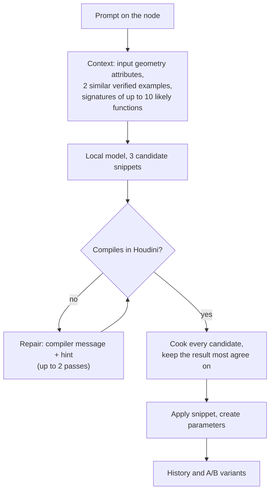

# ⚡ AI Attribute Wrangle: Local AI Copilot for VEX in SideFX Houdini

<div align="center">


[](https://huggingface.co/anshulVashist/Qwen3-8B-Houdini-VEX-v46)


**A local-first, zero-cloud AI copilot that writes VEX inside SideFX Houdini.**

[📥 Model Weights](#-model-weights) • [🚀 Quickstart](#-quickstart--installation) • [📊 How Good Is It?](#-how-good-is-it) • [✨ Features](#-key-features) • [⚙️ Settings](#️-settings)

</div>

---

## 📖 Overview

**AI Attribute Wrangle** is a Houdini SOP digital asset (`ai_attribwrangle.hda`): an Attribute Wrangle with a prompt
field. You describe what the wrangle should do in plain English, and a fine-tuned local model
(**Qwen3-8B-Houdini-VEX**) writes the VEX, which is compiled and cooked on the node before you see it.

- **100% offline**: the model runs on your own GPU through a bundled `llama.cpp` server on `127.0.0.1`. Prompts,
  geometry and code never leave the workstation.
- **Grounded prompts**: every request is sent together with the attributes of your input geometry, the most
  similar verified examples from a bank of 410, and the exact signatures of the VEX functions the task probably
  needs, read from the help of your own Houdini installation.
- **Checked answers**: three candidate snippets are generated, each is compiled and cooked on the node, and the
  result most candidates agree on is kept. Compiler errors go back to the model together with a hint.
- **Interface included**: `chf` / `chv` / `chi` / `chramp` calls in the answer become sliders, vector fields and
  ramps on the node.
- **Non-destructive**: every answer is one undo step, with a version history and A/B variants on the node.

It is an assistant, not an oracle: on held-out tasks it solves about seven in ten (see
[How good is it?](#-how-good-is-it)). Review generated code before it goes into a shot.

---

## 🧩 How It Works



1. **Context.** The node reads its inputs (up to four): attributes with their types, groups, bounding boxes and
   volumes. Two worked examples are
   retrieved from `data/vex_card_bank.json` (410 tasks whose reference code was executed and checked in Houdini).
   A function lookup combines the Houdini help, plain-language search phrases and the functions used by similar
   solved tasks, and puts the signatures of up to ten likely functions directly in front of the task.
2. **Generation.** The model answers three times (one low-temperature answer plus variations).
   In *Deep Reasoning* mode it thinks first and gives a single answer; its reasoning is shown in the
   *Reasoning Trace* tab.
3. **Compile first.** The model's code is tried as written; correct code is never rewritten. Only if Houdini
   rejects it are syntax repairs tried, then up to two repair requests that carry the compiler's message and a
   targeted hint: the likely intended function for an unknown name, the documented signatures for a call with
   the wrong arguments, `@P` for a bare `P`.
4. **Agreement.** All compiling candidates are cooked on the node and the output geometry most of them agree on
   wins. An answer without any VEX is never applied, so a working snippet cannot be wiped by a bad reply.
5. **Apply.** The snippet, the *Run Over* class and the generated parameters are set in one undo step.

---

## 📊 How Good Is It?

Measured on **284 held-out tasks** in six suites (attributes, geometry queries, topology, volumes, strings and
arrays, simulation-style maths, and more). A task counts as solved only when the **cooked geometry** matches the
expected result in Houdini 21.0.440; compiling is not enough.

| Model | Model alone (one answer) | Full plugin pipeline |
| :--- | :---: | :---: |
| v46 (first suite only, 57 tasks) | 19 / 57 | 32 / 57 |
| v51 | 117 / 284 | 143 / 284 |
| v53b | 138 / 284 | 188 / 284 |
| **v55 (current)** | **166 / 284 (58%)** | **199 / 284 (70%)** |

How to read this:

- The tasks were written separately from the training data, and the five newer suites are sealed: during
  development only their total scores are looked at, never the tasks. They are not in this repository, so that
  they stay unseen.
- On the 133 sealed tasks that resemble none of the training examples, v55 solves 82 through the plugin
  (v53b: 74).
- Small differences are noise: any change to the prompt flips 10 to 15% of the tasks in both directions. v55 is
  clearly better than v53b on its own (sealed suites: 44 tasks gained, 21 lost). Through the plugin the gain is
  smaller and not yet statistically solid (34 gained, 23 lost).
- Roughly three answers in ten are wrong on tasks of this kind. The usual causes are the logic of the task, the
  choice of function and argument order, not syntax.

---

## ✨ Key Features

### 1. 🪄 Generate and edit from a prompt
**✦ Generate** writes a new snippet. If the node already has code and the prompt asks for a change
("fix…", "tweak…", "optimize…", "document code…", "instead of…"), the existing snippet is edited instead of
replaced.

### 2. 🗳️ Candidates and execution vote
*AI Candidates* (default 3) sets how many answers are generated for a new snippet. Each is cooked on the node;
the result most candidates agree on is used, and the trace says how many agreed.

### 3. 🔁 Compiler-in-the-loop repair
Code that Houdini rejects is repaired with the live compiler message plus a hint taken from the compiler's own
list of 951 function signatures.

### 4. 🧠 Deep Reasoning mode
For hard problems (matrices, quaternions, multi-step geometry logic) the model plans in a thinking pass first.
Slower; one answer instead of three.

### 5. 🎛️ Dynamic parameters
`chf("scale")`, `chv("direction")`, `chramp("falloff", d)` in the answer create the matching controls on the node.

### 6. ⏳ History and A/B variants
Step through earlier versions (**◀ Prev** / **Next ▶**), store two variants (**Set as A** / **Set as B**) and
swap between them.

### 7. 🧰 Tools on the node
*Auto-Detect Class* (point / primitive / detail / vertex from the prompt), 11 FX presets (PBD cloth, RK4
advection, Verlet step, curl noise, differential growth, FABRIK IK, reaction-diffusion and others),
**🛡 Sanitize** (zero-division and NaN guards), **📊 Stats**, **📝 Help Card** and **💾 Export .h**.

### 8. 🔀 Model menu
*AI Model* lists the model files in `models/`, with the benchmark score of the versions that were measured.
**Auto** uses the newest fine-tuned version; *Custom Model File* accepts any GGUF.

---

## 🚀 Quickstart & Installation

**Requirements**: Windows 10/11 x64, SideFX Houdini (developed and tested on 21.0.440), a Vulkan-capable GPU.
The current model is 6.7 GB; it was developed on an RTX 3080 (10 GB), where it runs fully on the GPU. With less
free video memory part of the model runs on the CPU, which is slower (see `AI_WRANGLE_GPU_LAYERS` below).

### Option 1: Setup wizard (recommended)
1. Clone or download this repository to a permanent folder.
2. Put a model file into the `models/` folder (see [Model Weights](#-model-weights)).
3. Double-click **`Install.bat`** (or run `python installer_gui.py`).
4. Select your Houdini version(s) and click **"🚀 1-Click Install"**.
5. Launch Houdini.

### Option 2: Drag and drop inside Houdini (no restart)
1. Open Houdini.
2. Drag **`install_in_houdini.py`** into the viewport or the Python Shell (or use `File -> Run Script`).
3. The node is installed and loaded into the running session.

### Option 3: Manual package setup
If you cloned this repository into your Houdini `packages/` directory as `Houdini-Ai-Attribute-Wrangle`:
1. Copy **`ai_attribwrangle.json`** into the parent `packages/` folder
   (`$HOUDINI_USER_PREF_DIR/packages/ai_attribwrangle.json`).
2. If `bin/llama-server.exe` is missing, install the inference engine with PowerShell:
   ```powershell
   winget install ggml.llamacpp
   ```
3. Launch Houdini.

The installers do not copy the plugin: Houdini loads it from the folder you cloned, so keep that folder.

**First use.** The first request starts the local engine and loads the model (this can take a minute). The
function lookup builds its reference from your Houdini help the first time it is needed (a fraction of a second)
and stores it as `data/vex_function_reference.json`.

---

## 🔗 Model Weights

Model files are not part of this repository. Put one or more GGUF files into `models/`; **Auto** picks the
highest `Qwen3-8B-Houdini-VEX-vNN` version it finds.

| Model | File | Size | Status |
| :--- | :--- | :---: | :--- |
| **v55** (current, all figures above) | `Qwen3-8B-Houdini-VEX-v55-nf4deq-Q6_K.gguf` | 6.7 GB | Not uploaded to Hugging Face yet |
| v46 | [`Qwen3-8B-Houdini-VEX-v46-Q5_K_M.gguf`](https://huggingface.co/anshulVashist/Qwen3-8B-Houdini-VEX-v46) | 5.9 GB | Newest public download |
| v30, v11, v10 | [Hugging Face: anshulVashist](https://huggingface.co/anshulVashist) | 5.9 GB | Older versions |

All versions are full merged models (no separate adapter needed), fine-tuned from
[Qwen3-8B](https://huggingface.co/Qwen/Qwen3-8B) (Apache 2.0) with QLoRA. v55 was trained on 458 *concept cards*:
small tasks in several phrasings whose reference code is executed in Houdini and checked before it is used.
The plugin works with any of them; the newer the model, the better the answers (see the table above).

---

## 🎯 How to Use in Houdini

1. In a Geometry network (`/obj/geo`), press **TAB** and add an **AI Attribute Wrangle** node.
2. Connect your geometry, then describe the result in the **Prompt** field:
   > *"Color each point by its distance along the surface to the nearest point of group `src`, blue to red."*
3. Click **✦ Generate**.
4. The snippet appears in **VEXpression**, already compiled and cooked; any `chf` / `chv` / `chramp` controls
   appear on the node.

Tips: name attributes and groups as they are called in your scene, say what should be written where
("store it in `f@dist`"), and give units or ranges when they matter. Press **Esc** to cancel a generation.

---

## 💡 Example Prompt & Generated VEX

### Prompt:
> *"Create an audio-reactive ripple wave displacing points outward with dampening falloff and normal recalculation."*

### Generated VEX:
```c
// Calculate planar distance from origin
vector pos = @P;
float dist = length(set(pos.x, 0, pos.z));

// Dynamic Parameters
float freq = chf("wave_frequency");
float speed = chf("wave_speed");
float amp = chf("wave_amplitude");
float decay = chf("damping_decay");

// Compute concentric wave with exponential damping
float wave = sin(dist * freq - @Time * speed) * exp(-dist * decay);
@P.y += wave * amp;

// Analytical normal recalculation for smooth shading
float d_wave = (freq * cos(dist * freq - @Time * speed) - decay * sin(dist * freq - @Time * speed)) * exp(-dist * decay) * amp;
vector grad = normalize(set(pos.x, 0, pos.z)) * d_wave;
vector tangent_x = set(1.0, grad.x, 0.0);
vector tangent_z = set(0.0, grad.z, 1.0);
@N = normalize(cross(tangent_z, tangent_x));

// Color ramp visualization
@Cd = chramp("wave_color", fit(wave, -1.0, 1.0, 0.0, 1.0));
```

---

## ⚙️ Settings

Everything works without configuration. These environment variables (set them before Houdini starts, for example
in `houdini.env` or the package file) change the defaults:

| Variable | Default | Effect |
| :--- | :---: | :--- |
| `AI_WRANGLE_MODEL_PATH` | | Model file used for **Auto** instead of the newest one in `models/` |
| `AI_WRANGLE_GPU_LAYERS` | automatic | Number of model layers on the GPU (0 to 36); lower it on small cards |
| `AI_WRANGLE_PORT` | 58421 | Port of the local engine (a free port is chosen if it is taken) |
| `AI_WRANGLE_ENGINE_BIN` | `bin/llama-server.exe` | Another `llama-server` executable |
| `AI_WRANGLE_EXAMPLES` | 1 | `0`: no worked examples |
| `AI_WRANGLE_EXAMPLES_K` | 2 | Number of worked examples in the prompt |
| `AI_WRANGLE_CARD_BANK` | `data/vex_card_bank.json` | Another example bank |
| `AI_WRANGLE_FUNCTION_INDEX` | 1 | `0`: the older keyword matcher instead of the function lookup |
| `AI_WRANGLE_FUNCTION_INDEX_K` | 10 | Number of functions offered in the reference block |
| `AI_WRANGLE_FUNCTION_ALIASES` | 1 | `0`: lookup without the plain-language search phrases |
| `AI_WRANGLE_FUNCTION_NOTES` | 0 | `1`: add short usage notes to 140 functions (experimental, no measured gain) |
| `AI_WRANGLE_BUILD_REFERENCE` | 1 | `0`: do not build the function reference from the local Houdini help |
| `AI_WRANGLE_REFERENCE_LAST` | 1 | `0`: reference block at the top of the prompt instead of next to the task |
| `AI_WRANGLE_API_HINTS` | 1 | `0`: repair requests without the hint |
| `AI_WRANGLE_BLUEPRINTS` | 0 | `1`: the older code blueprints in the prompt (they lowered the scores) |

Two settings live on the node itself, under *Advanced Options*: **AI Candidates** (number of answers, 1 to 8) and
**SideFX Micro-RAG** (off: the prompt is sent without worked examples and function reference; the geometry
context stays).

---

## 📂 Repository Structure

```
Houdini-Ai-Attribute-Wrangle/
├── 📂 bin/                            <- Inference engine (llama.cpp server, Vulkan and CPU runtimes)
├── 📂 otls/
│   └── 📄 ai_attribwrangle.hda        <- The Houdini SOP digital asset
├── 📂 python/
│   ├── 📄 houdini_ai_wrangle.py       <- Node controller: prompts, candidates, compile and repair loop, UI
│   ├── 📄 engine_manager.py           <- Starts and stops the local engine, GPU memory estimate
│   ├── 📄 vex_example_bank.py         <- Retrieval of verified examples
│   ├── 📄 vex_function_index.py       <- Function lookup: which functions a task needs, and their signatures
│   ├── 📄 vex_function_reference.py   <- Builds the function reference from the local Houdini help
│   ├── 📄 vex_api_hints.py            <- Hints for compiler errors (unknown function, wrong arguments, ...)
│   ├── 📄 vex_rag_engine.py           <- Assembles the context block; older function database
│   ├── 📄 vex_ground_truth_signatures.py  <- Hand-checked signatures for the older database
│   ├── 📄 license_validator.py        <- License check for encrypted model packages
│   └── 📄 model_vault.py              <- Loading of encrypted model packages
├── 📂 data/
│   ├── 📄 vex_card_bank.json          <- 410 verified examples (task, reasoning, code)
│   ├── 📄 vex_function_aliases.json   <- Plain-language search phrases for 367 functions
│   ├── 📄 vex_function_notes.json     <- Usage notes for 140 functions (off by default)
│   ├── 📄 vex_signatures_vcc.json     <- The compiler's signature list (951 functions, from `vcc -X cvex`)
│   └── 📄 vex_1115_compact.json       <- Function database of the older retrieval path
├── 📂 tools/                          <- Tests and maintenance scripts (see below)
├── 📂 release/                        <- EULA, privacy, third-party notices, model provenance
├── 📄 ai_attribwrangle.json           <- Houdini package definition
├── 🚀 Install.bat                     <- Windows setup wizard launcher
├── 📄 installer_gui.py                <- Setup wizard
├── 📄 install_in_houdini.py           <- Drag-and-drop installer for a running Houdini
├── 📄 CHANGELOG.md
├── 📄 LICENSE                         <- Apache 2.0
└── 📄 README.md
```

Training scripts, training data and the held-out benchmark suites are private and not part of this repository.

---

## 🖥️ Inference Engine (llama.cpp)

The plugin starts `bin/llama-server.exe` in the background (no console window) the first time a model is needed:

- **Local only**: it listens on `127.0.0.1` and requires a random key that is generated for each Houdini
  session, so other programs cannot use it.
- **GPU**: the bundled build uses Vulkan. Free video memory is read with `nvidia-smi` to decide how much of the
  model goes on the GPU.
- **Clean exit**: the engine is closed together with Houdini, also after a crash.
- **Other builds**: if `bin/llama-server.exe` is missing, a system-wide llama.cpp is used:
  ```powershell
  winget install ggml.llamacpp
  ```

---

## 🧪 Development & Tests

```bash
hython tools/test_hda_hython.py
```

runs 139 end-to-end checks of the node inside Houdini (no GPU or model needed: the model's answers are mocked,
everything else is real: HDA, parameters, compile and cook, repair loop, history, function lookup, hints).

| Script | Purpose |
| :--- | :--- |
| `tools/test_hda_hython.py` | The plugin's test suite |
| `tools/test_engine_live.py` | Live test of the real engine: start, key check, generate, cancel (needs the GPU for about a minute) |
| `tools/build_function_reference.py` | Rebuild the function reference by hand, for example after a Houdini upgrade |
| `tools/vex_validate.py` | Compile and cook a file of VEX snippets in a Houdini test scene |
| `tools/validate_signatures.py` | Check the hand-written signature list against the compiler's own |

See [CHANGELOG.md](CHANGELOG.md) for the history of models, measurements and fixes.

---

## 📜 License

The code and the data files in this repository are licensed under the **Apache License 2.0**, see
[LICENSE](LICENSE). The model weights are derived from Qwen3-8B (Apache 2.0). `bin/` contains llama.cpp (MIT),
see [release/THIRD_PARTY_NOTICES.txt](release/THIRD_PARTY_NOTICES.txt).

Houdini and VEX are products of SideFX; this project is not affiliated with or endorsed by SideFX. The function
reference is built on your machine from your own Houdini help and is not distributed here.

Developed with ❤️ for the Houdini & VFX community by **Anshul Vashist**.
